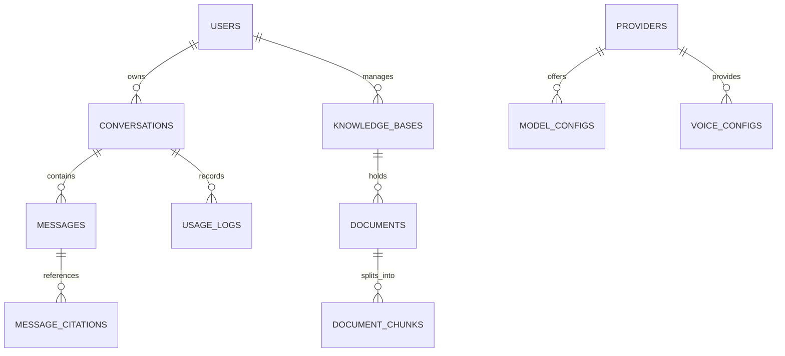

# VoiceRag — Database Schema Specification

## 1. Relational Database Overview
The relational persistence layer uses **SQLAlchemy 2.0 Declarative Models** backed by **SQLite** configured in **Write-Ahead Logging (WAL)** mode. The schema is fully normalized and supports future migration to PostgreSQL without changes to application queries.

## 2. Table Definitions

### 2.1 `users`
- `id` (VARCHAR(36), PK): UUID4
- `email` (VARCHAR(255), UNIQUE, NOT NULL)
- `hashed_password` (VARCHAR(255), NOT NULL)
- `full_name` (VARCHAR(255))
- `role` (VARCHAR(50), DEFAULT 'user'): 'admin', 'user', 'operator'
- `is_active` (BOOLEAN, DEFAULT TRUE)
- `created_at` (DATETIME, UTC)
- `updated_at` (DATETIME, UTC)

### 2.2 `conversations`
- `id` (VARCHAR(36), PK): UUID4
- `user_id` (VARCHAR(36), FK -> users.id, NULLABLE for anonymous sessions)
- `title` (VARCHAR(255), DEFAULT 'New Conversation')
- `knowledge_base_id` (VARCHAR(36), FK -> knowledge_bases.id, NULLABLE)
- `language` (VARCHAR(10), DEFAULT 'auto'): 'auto', 'en', 'ar'
- `mode` (VARCHAR(50), DEFAULT 'hybrid'): 'chat', 'voice', 'rag_strict', 'rag_first'
- `created_at` (DATETIME, UTC)
- `updated_at` (DATETIME, UTC)

### 2.3 `messages`
- `id` (VARCHAR(36), PK): UUID4
- `conversation_id` (VARCHAR(36), FK -> conversations.id, ON DELETE CASCADE)
- `role` (VARCHAR(20), NOT NULL): 'user', 'assistant', 'system'
- `content` (TEXT, NOT NULL)
- `intent` (VARCHAR(50)): 'greeting', 'smalltalk', 'knowledge', 'noise'
- `language` (VARCHAR(10)): 'en', 'ar'
- `audio_url` (VARCHAR(500), NULLABLE)
- `audio_duration_seconds` (FLOAT, DEFAULT 0.0)
- `tokens_input` (INTEGER, DEFAULT 0)
- `tokens_output` (INTEGER, DEFAULT 0)
- `latency_ms` (FLOAT, DEFAULT 0.0)
- `cost_estimated` (FLOAT, DEFAULT 0.0)
- `created_at` (DATETIME, UTC)

### 2.4 `knowledge_bases`
- `id` (VARCHAR(36), PK): UUID4
- `name` (VARCHAR(255), NOT NULL)
- `description` (TEXT)
- `embedding_model` (VARCHAR(255), DEFAULT 'sentence-transformers/paraphrase-multilingual-mpnet-base-v2')
- `vector_dimension` (INTEGER, DEFAULT 768)
- `is_archived` (BOOLEAN, DEFAULT FALSE)
- `document_count` (INTEGER, DEFAULT 0)
- `total_chunks` (INTEGER, DEFAULT 0)
- `created_at` (DATETIME, UTC)
- `updated_at` (DATETIME, UTC)

### 2.5 `documents`
- `id` (VARCHAR(36), PK): UUID4
- `knowledge_base_id` (VARCHAR(36), FK -> knowledge_bases.id, ON DELETE CASCADE)
- `filename` (VARCHAR(255), NOT NULL)
- `file_type` (VARCHAR(50), NOT NULL): 'pdf', 'docx', 'xlsx', 'txt', 'md', 'url'
- `file_size_bytes` (INTEGER, NOT NULL)
- `storage_path` (VARCHAR(500), NOT NULL)
- `source_url` (VARCHAR(500), NULLABLE)
- `language` (VARCHAR(10), DEFAULT 'unknown')
- `status` (VARCHAR(50), DEFAULT 'pending'): 'pending', 'processing', 'indexed', 'failed'
- `chunk_count` (INTEGER, DEFAULT 0)
- `error_message` (TEXT, NULLABLE)
- `created_at` (DATETIME, UTC)
- `updated_at` (DATETIME, UTC)

### 2.6 `document_chunks`
- `id` (VARCHAR(36), PK): UUID4
- `document_id` (VARCHAR(36), FK -> documents.id, ON DELETE CASCADE)
- `chunk_index` (INTEGER, NOT NULL)
- `content` (TEXT, NOT NULL)
- `page_number` (INTEGER, NULLABLE)
- `section_heading` (VARCHAR(255), NULLABLE)
- `token_count` (INTEGER, DEFAULT 0)
- `qdrant_point_id` (VARCHAR(64), NOT NULL)
- `created_at` (DATETIME, UTC)

### 2.7 `message_citations`
- `id` (VARCHAR(36), PK): UUID4
- `message_id` (VARCHAR(36), FK -> messages.id, ON DELETE CASCADE)
- `document_id` (VARCHAR(36), FK -> documents.id)
- `chunk_id` (VARCHAR(36), FK -> document_chunks.id)
- `citation_index` (INTEGER, NOT NULL)
- `cited_text` (TEXT, NOT NULL)
- `page_number` (INTEGER, NULLABLE)
- `relevance_score` (FLOAT, DEFAULT 0.0)

### 2.8 `ai_settings`
- `id` (VARCHAR(36), PK): UUID4
- `llm_provider` (VARCHAR(50), NOT NULL)
- `llm_model` (VARCHAR(100), NOT NULL)
- `stt_provider` (VARCHAR(50), NOT NULL)
- `stt_model` (VARCHAR(100), NOT NULL)
- `tts_provider` (VARCHAR(50), NOT NULL)
- `tts_model` (VARCHAR(100), NOT NULL)
- `voice_id` (VARCHAR(100), NOT NULL)
- `default_language` (VARCHAR(10), DEFAULT 'auto')
- `router_enabled` (BOOLEAN, DEFAULT TRUE)
- `router_profile` (VARCHAR(50), DEFAULT 'balanced')
- `updated_at` (DATETIME, UTC)

### 2.9 `usage_logs`
- `id` (VARCHAR(36), PK): UUID4
- `request_id` (VARCHAR(64), NOT NULL)
- `conversation_id` (VARCHAR(36), NULLABLE)
- `provider` (VARCHAR(50), NOT NULL)
- `model` (VARCHAR(100), NOT NULL)
- `capability` (VARCHAR(50), NOT NULL): 'llm', 'stt', 'tts', 'embeddings'
- `tokens_input` (INTEGER, DEFAULT 0)
- `tokens_output` (INTEGER, DEFAULT 0)
- `audio_seconds` (FLOAT, DEFAULT 0.0)
- `latency_ms` (FLOAT, NOT NULL)
- `estimated_cost` (FLOAT, NOT NULL)
- `status_code` (INTEGER, DEFAULT 200)
- `created_at` (DATETIME, UTC)

