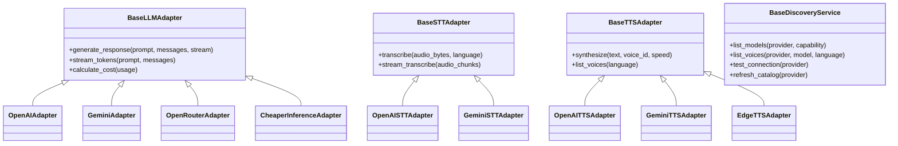

# VoiceRag — Unified AI Provider Architecture

## 1. Provider Independence Mandate
The core application domain logic is strictly decoupled from individual provider SDKs. VoiceRag provides an abstracted adapter interface for all external AI services:

## 2. Dynamic Provider Discovery & Capability Matrix

| Provider | LLM Support | STT Support | TTS Support | Embedding Support | Model Discovery Endpoint |
| :--- | :---: | :---: | :---: | :---: | :--- |
| **OpenAI** | Yes | Yes (Whisper) | Yes (TTS-1) | Yes (text-embedding-3) | Official `/v1/models` |
| **Google Gemini**| Yes | Yes (Multimodal)| Yes (Native Audio)| Yes (text-embedding-004)| Official `client.models.list` |
| **OpenRouter** | Yes | No | No | No | Official `/api/v1/models` |
| **CheaperInference**| Yes | No | No | Yes | OpenAI-compatible `/v1/models` |

## 3. Dynamic Configuration Engine
1. **Zero Hardcoded Dropdowns**: The UI queries `/api/v1/providers/{provider}/models` dynamically.
2. **Independent Capability Selection**: A user can run OpenRouter for LLM, OpenAI for STT, and Gemini for TTS. Changing one capability never resets or interferes with another.
3. **Secret Masking**: Stored keys are never reflected back in plaintext; masked representations (`sk-or-v1-****5a9b`) are transmitted to client settings.
4. **Resilient In-Memory & DB Cache**: Discovered model catalogs are cached for 1 hour with a manual `Refresh Models` action to prevent unnecessary rate limiting.
