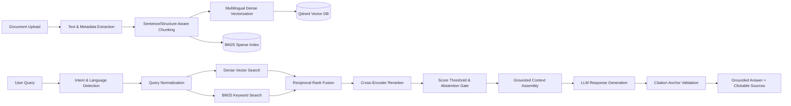

# VoiceRag — Advanced RAG Architecture

## 1. Pipeline Overview
The Retrieval-Augmented Generation pipeline is engineered for high-precision, multilingual (English and Arabic) fact-grounded synthesis with verifiable citation traceability.

## 2. Ingestion Pipeline
1. **Multi-Format Extraction**:
   - PDF: `pypdf` with page-by-page text extraction, unicode normalization, and bounding/page markers.
   - DOCX: `python-docx` traversing paragraphs, tables, and heading levels.
   - XLSX/CSV: Table row serializing with column header retention.
   - TXT / Markdown: Clean markdown header hierarchy preservation.
2. **Structure-Aware Chunking**:
   - Default Chunk Size: 500 characters / ~120 tokens.
   - Chunk Overlap: 100 characters to prevent loss of context across boundaries.
   - Metadata Stored per Chunk: `knowledge_base_id`, `document_id`, `chunk_id`, `page_number`, `section_heading`, `source_url`.
3. **Multilingual Embedding Generation**:
   - Model: FastEmbed `sentence-transformers/paraphrase-multilingual-mpnet-base-v2` (768-dimensional) or multilingual BGE embedding model.
   - Vector Storage: Qdrant collection with cosine distance metric and payload indexing for instantaneous KB-level filtering.

## 3. Hybrid Retrieval & Fusion
- **Dense Vector Search**: Qdrant cosine similarity ranking.
- **Sparse Keyword Search**: BM25Okapi tokenized search capturing exact keyword hits, identifiers, and codes.
- **Reciprocal Rank Fusion (RRF)**:
  \[
  RRF\_Score(d) = \sum_{m \in \{Dense, Sparse\}} \frac{1}{k + rank_m(d)} \quad (k = 60)
  \]
- **Cross-Encoder Reranking**: Re-evaluates top 15 candidate passages through cross-attention to produce final calibrated relevance scores.

## 4. Grounding & Abstention Policy
- **Grounded Answer Contract**: The LLM system prompt strictly forbids speculation. Answers must cite specific document passages.
- **Honest Abstention**: If the top fused relevance score falls below the configured threshold (default `0.35`), the assistant responds honestly with an abstention message rather than hallucinating.
