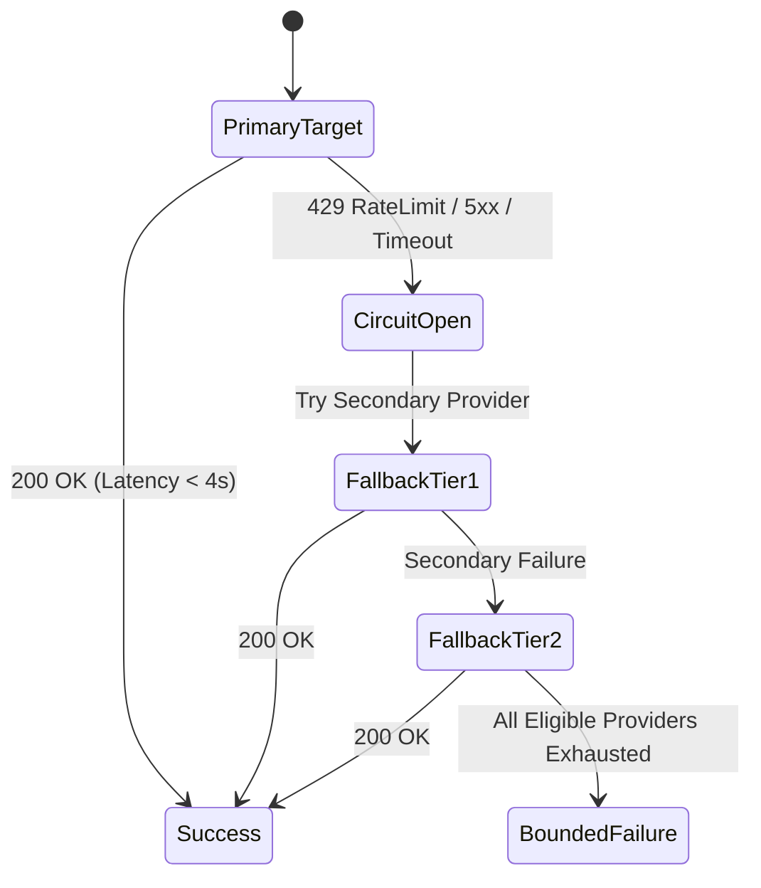

# VoiceRag — Smart Auto Router Architecture

## 1. Concept & Objectives
The **Smart Auto Router** is an intelligent, application-level dispatch engine that dynamically selects the optimal model for an incoming task based on:
1. **Task Complexity**: Lightweight small-talk vs complex analytical RAG synthesis.
2. **Context Window Requirements**: Document passage length and token volume.
3. **Latency Constraints**: Sub-second audio synthesis vs deep reasoning.
4. **Financial Cost**: Minimizing token consumption while preserving accuracy.
5. **Availability & Circuit Breaking**: Detecting provider outages, rate limits, or quota exhaustion and seamlessly degrading to fallbacks.

## 2. Routing Profiles
- **Low Cost**:
  - Prioritizes models such as Gemini 2.5 Flash, CheaperInference low-cost endpoints, or GPT-4o-mini.
  - Target: Cost < \$0.20 per 1M tokens.
- **Balanced (Default)**:
  - Balances latency, reasoning capability, and expenditure.
  - Target: Claude 3.5 Haiku, Gemini 1.5/2.5 Flash, GPT-4o.
- **High Quality**:
  - Directs complex knowledge synthesis to Claude 3.5 Sonnet, GPT-4o, or Gemini 1.5 Pro.
- **Maximum Capability**:
  - Leverages deep reasoning models with highest context length.

## 3. Circuit Breaker & Fallback Matrix

- **Idempotency & Cost Guard**: Non-idempotent operations are never blindly re-executed in parallel. Retries are strictly bounded to 2 attempts with exponential jitter.
