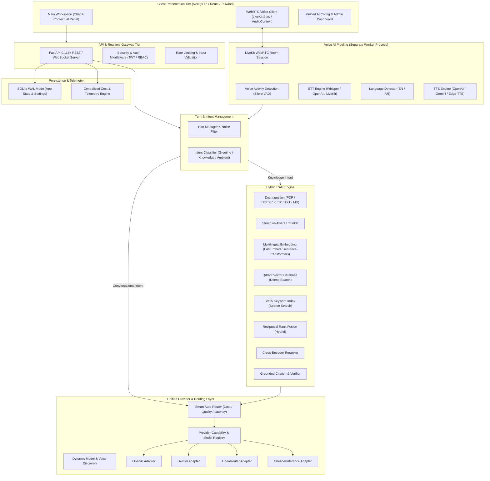

# VoiceRag — System Architecture

## Architectural Highlights
1. **Modular Monolith Backend**: FastAPI coordinates state, REST APIs, and background processing while delegating real-time audio streams to a non-blocking voice worker.
2. **Dual-Path Intent Routing**: Queries first evaluate intent before invoking dense/sparse retrieval to eliminate unnecessary vector computation on simple greetings.
3. **Decoupled Providers**: All external AI providers implement uniform protocols for LLM, STT, TTS, Embeddings, and Reranking.
4. **Resilient Local Persistence**: SQLite configured in Write-Ahead-Logging (WAL) mode guarantees high concurrency without lock contention during simultaneous ingestion and chat streaming.
